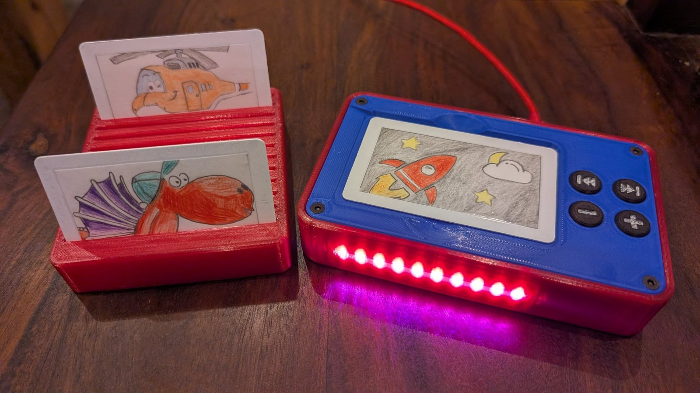
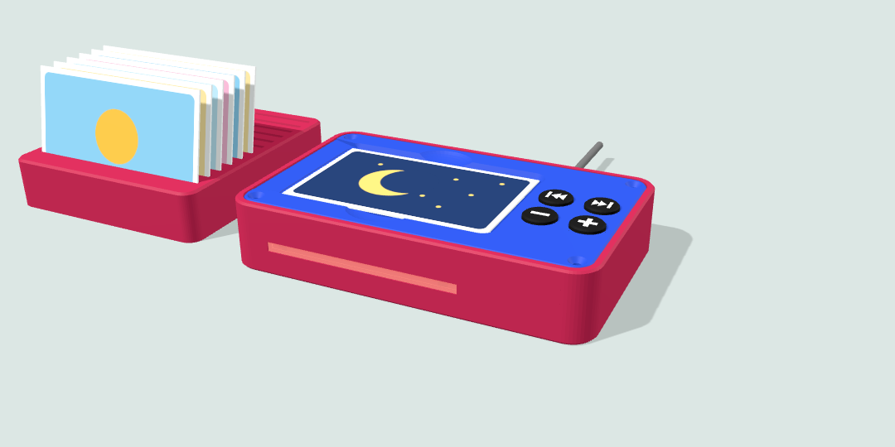

# Loxone Kinder-Musikbox

Eine Musikbox für Kinder zum Selberbauen: Karte mit Bild auflegen, die Musik startet. Karte wegnehmen, die Musik stoppt. Gesteuert wird der **Loxone Audioserver** (z. B. mit Spotify-Favoriten), die Box selbst spielt keine Musik ab.



**[3D-Ansicht im Browser](https://mart2549.github.io/loxone-kinder-musikbox/)**: drehbar, mit geöffnetem Deckel, Innenleben und Explosionsansicht.



## Funktionen

- NFC-Karten mit Bild vorne und Nummer auf dem Chip, jede Nummer startet einen Favoriten
- 4 Tasten: leiser, lauter, vorheriger und nächster Titel (nur aktiv, solange eine Karte liegt)
- Lichtleiste an der Front zeigt „Karte erkannt“, „Karte ohne Nummer“ und „Kein Netzwerk“; Farbe, Helligkeit und Blinkmuster auf der Statusseite einstellbar
- WLAN, Versorgung über USB-C (5 V, ca. 0,5 W ohne Karte)
- Kein Loxone-Benutzer in der Box: Die Box sendet nur kurze UDP-Telegramme an einen virtuellen Eingang
- Eine Firmware für mehrere Boxen: Loxone-Adresse und Port auf der Statusseite einstellbar
- Updates über die Statusseite im Browser, Ereignislog mit Zeitstempel
- Kartenständer für 12 Karten

## So funktioniert es

```
Karte (NFC) → PN532 → XIAO ESP32C3 (ESPHome) → WLAN/UDP → Loxone Miniserver → Audio Player → Lautsprecher
```

Die Kartennummer ist die Favoriten-ID des Audio Players. Karte 3 startet Favorit 3.

## Bauteile

| Teil | Menge |
|---|---|
| Seeed XIAO ESP32C3 (mit Antenne) | 1 |
| PN532 NFC-Modul (I2C) | 1 |
| WS2812B-Stick, 10 LEDs, 80 × 10 mm (Soldered) | 1 |
| Kurzhubtaster 6 × 6 mm, Höhe 5,0 mm | 4 |
| Lochrasterplatine 2,54 mm, 1N4001, 330 Ω, Elko 100 bis 220 µF (optional) | je 1 |
| NFC-Karten MIFARE Classic 1K oder NTAG | nach Bedarf |
| Schrauben M3 × 16 Senkkopf (4), M2,5 × 5 (3), Litze, USB-Netzteil 5 V 1 A | |

Elektronik und Schrauben kosten etwa 40 € (Stand 09/2026). Vollständige Liste mit Bezugsquellen: [doku/Stueckliste.pdf](doku/Stueckliste.pdf)

## 3D-Druck

| Datei | Hinweis |
|---|---|
| `unterteil_fenster_offen.stl` | Unterteil mit offenem Lichtfenster |
| `unterteil_fenster_zu.stl` | Fenster außen mit 0,6 mm Haut geschlossen, lässt sich später herausschneiden |
| `lichtleiste_duenn.stl` | Lichtleiste für das offene Fenster (heller), `lichtleiste.stl` massiv |
| `lichtleiste_dummy_rahmen.stl` | Rahmen für das geschlossene Fenster, Licht scheint durch die Haut |
| `deckel.stl` | Muldenboden voll drucken (mind. 5 Deckschichten) |
| `tastkappen.stl` | 4 Kappen mit Symbolen, gern mit 0,12 bis 0,16 mm Schichthöhe |
| `kartenstaender.stl` | optional |
| `musikbox.scad` | OpenSCAD-Modell, alle Maße als Parameter |

- PLA oder PETG, 0,2 mm, mindestens 3 Wände, 5 Deckschichten, 20 % Füllung
- **Kein Stützmaterial.** Kein Teil braucht Stützen. Bei geschlossenem Fenster sind Stützen im Lichtschlitz später von außen sichtbar.
- **Lichtleiste:** In farbigem Filament kommt nur diese Farbe durch (Rot lässt kaum Grün und Blau durch). Für unterscheidbare Farben naturweiß oder klar drucken.

## Aufbau

- [Montageanleitung](doku/Montageanleitung.pdf): vom Druck bis zur Inbetriebnahme, etwa 3 bis 4 Stunden
- [Schaltplan und Verdrahtung](doku/Schaltplan.pdf)
- [Lochplatine](doku/Lochplatine.pdf)
- [Firmware](firmware/README.md): selbst bauen mit ESPHome (empfohlen) oder fertige Einsteiger-Firmware
- [Loxone einrichten](doku/Loxone_Einrichtung.md): virtueller UDP-Eingang, Logik zum Audio Player, Karten beschreiben

## Bekannte Schwächen von Version 1

- **XIAO-Halter:** Die gedruckten Schnapphaken können beim Einrasten abbrechen. Der XIAO hält dann gut mit Heißkleber.
- **XIAO-Auflage:** Die Auflagen laufen unter den Randkontakten durch. Liegt eine Lötstelle (meist am 5V-Pad) auf, die Auflage dort etwas ausschaben.
- **WLAN nach Updates:** ESPHome verwirft die über den Hotspot eingegebenen WLAN-Daten bei jeder neuen Firmware. Nach einem Update das WLAN über den Hotspot „Musikbox Setup“ neu einrichten (öffnet nach etwa 90 s).
- **Handy auf der Box:** Ein entsperrtes Handy mit NFC-Bezahlfunktion meldet ständig neue Kennungen, die Box zeigt dann „Karte ohne Nummer“. Es wird nichts gesendet.

Geplant für Version 2: XIAO-Halter ohne Schnapphaken, Auflagen nur in der Mitte, optional Gewindeeinsätze für die Deckelschrauben.

## Ordner

```
index.html  3D-Ansicht (über GitHub Pages im Browser)
3d-druck/   STL-Dateien und OpenSCAD-Modell
bilder/     Ansichten
doku/       Stückliste, Montageanleitung, Schaltplan, Lochplatine, Loxone-Einrichtung
firmware/   ESPHome-Quelltext, Vorlage secrets, fertige Einsteiger-Firmware
```

## Lizenz

Alle Dateien dieses Projekts stehen unter der [MIT-Lizenz](LICENSE): nachbauen, ändern und weitergeben erlaubt, auch kommerziell, mit Nennung des Urhebers und des Lizenztextes.

Die fertigen Firmware-Dateien (`.bin`) enthalten zusätzlich ESPHome, dessen C++-Teil unter GPLv3 steht, und die Improv-Bibliothek (MIT). Der Quelltext von ESPHome ist unter https://github.com/esphome/esphome verfügbar.

## Hinweise

- Nachbau auf eigene Gefahr. Die Box enthält Kleinteile und ist nicht für Kinder unter 3 Jahren ohne Aufsicht geeignet. Die Elektronik muss verschraubt im Gehäuse sitzen.
- Nur ein geprüftes USB-Netzteil (5 V, mindestens 1 A) verwenden.
- „Loxone“ ist eine Marke der Loxone Electronics GmbH. Dieses Projekt steht in keiner Verbindung zu Loxone.
